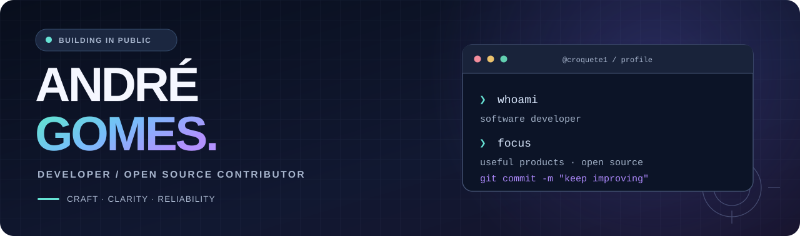

  <picture>
    <source media="(prefers-color-scheme: dark)" srcset="./assets/hero-dark.svg">
    <source media="(prefers-color-scheme: light)" srcset="./assets/hero-light.svg">
    
  </picture>

  <h3>Useful software. Clear architecture. Thoughtful experiences.</h3>
  
<strong>Full-stack development · Open-source contributions · Product craftsmanship</strong>

  

    <a href="#selected-work">Selected work</a> ·
    <a href="#open-source--stremio">Open source</a> ·
    <a href="https://github.com/croquete1?tab=repositories">Public repositories</a> ·
    <a href="./README.pt.md">Português 🇵🇹</a>
  

  

    <code>TypeScript</code> &nbsp; <code>React</code> &nbsp; <code>Next.js</code> &nbsp;
    <code>Node.js</code> &nbsp; <code>Rust</code> &nbsp; <code>Ruby on Rails</code>
  

---

### About

I'm André, a developer who enjoys turning complex requirements into **useful, maintainable software**. My focus is on clear architecture, dependable systems, polished interfaces and the small details that improve a product.

I build across the stack and contribute to open-source projects, including [Stremio](https://github.com/Stremio).

### Selected work

<table>
  <tr>
    <td width="50%" valign="top">
      <h3><a href="https://github.com/croquete1/observatory">↗ Open Tender Watch</a></h3>
      
Exploring transparency in public procurement, with documented risk indicators for human review — not accusations or automated conclusions.

      
<code>Rails</code> <code>Hotwire</code> <code>SQLite</code>

    </td>
    <td width="50%" valign="top">
      <h3><a href="https://github.com/croquete1/Fitness-Pro">↗ Fitness-Pro</a></h3>
      
A fitness-management dashboard featuring authentication, role-based access control, administration tools and structured product workflows.

      
<code>Next.js</code> <code>TypeScript</code> <code>Prisma</code>

    </td>
  </tr>
</table>

### Open source · Stremio

I contribute improvements to the Stremio ecosystem, spanning application behaviour, compatibility and localisation. Some selected public contributions:

| Repository | Contribution |
|:--|:--|
| [stremio-shell-ng](https://github.com/Stremio/stremio-shell-ng/pull/109) | Retry single-instance handoff when another instance owns the pipe · PR #109 |
| [stremio-shell-ng](https://github.com/Stremio/stremio-shell-ng/pull/110) | Safer handling of locally dropped files · PR #110 |
| [stremio-core](https://github.com/Stremio/stremio-core/pull/1068) | Support statistics requests without a file index · PR #1068 |
| [stremio-web](https://github.com/Stremio/stremio-web/pull/1474) | Skip view transitions on WebKitGTK · PR #1474 |

<a href="https://github.com/pulls?q=is%3Apr+author%3Acroquete1+org%3AStremio">All public Stremio pull requests →</a>

### Tools & technologies

| Frontend | Backend & systems | Data & workflow |
|:--|:--|:--|
| TypeScript · JavaScript | Node.js · Rust | PostgreSQL · SQLite |
| React · Next.js | Ruby · Rails | Git · GitHub |
| HTML · CSS | APIs · application architecture | Testing · code review |

### Principles

> Make complexity understandable. Build for real people. Test what matters. Keep improving.

---

  Only public projects and contributions are featured here.
  
<a href="https://github.com/croquete1?tab=repositories">Explore public repositories →</a>

